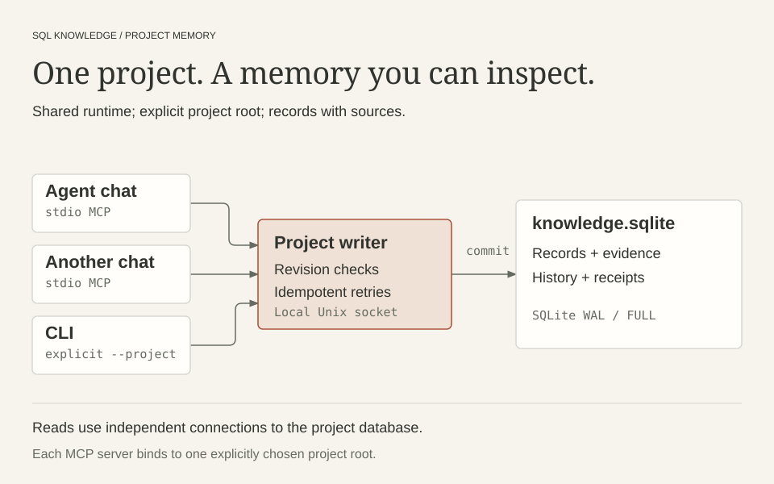
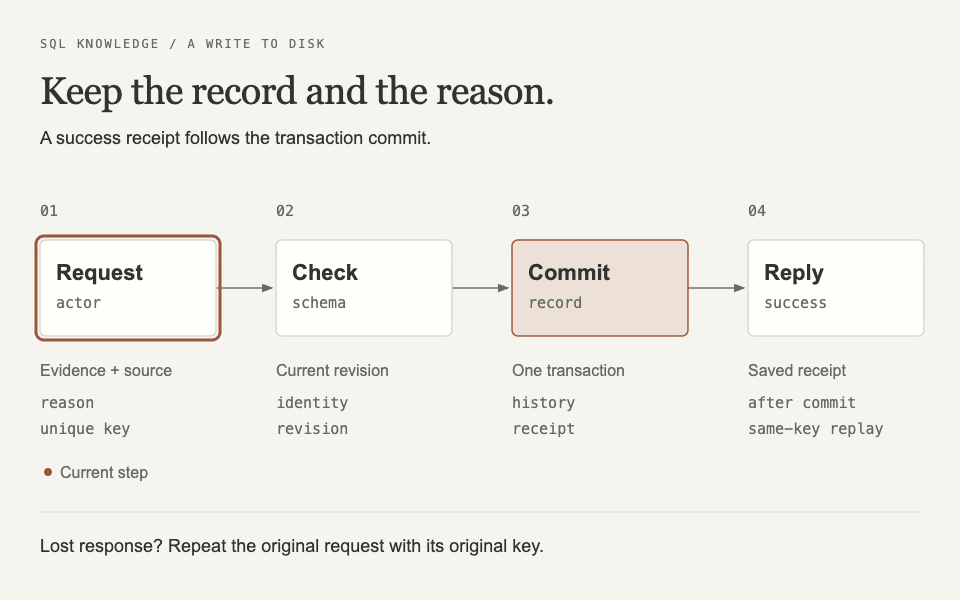

# SQL Knowledge

Project memory for coding agents, stored in a local SQLite database.

Keep decisions, findings and their sources across chats. Connect your agent through
MCP, or use the CLI to inspect the same project. Each record has an identity and
history, so you can check who changed it and why.



## A task you could give it

> Read this project's decisions before changing the import pipeline. When the work
> is verified, save the result with the test report as evidence. Mark assumptions
> as inferred and link the decision I approved.

The agent loads accepted decisions and constraints, searches for relevant records,
then reads their full cards. When it saves a finding, it includes a source and a
reason. You can inspect that record from another chat without relying on the
previous conversation being in context.

SQL Knowledge stores facts and decisions that an agent explicitly records. It does
not capture your chats or decide whether a claim is true. The skill asks the agent
to distinguish observations, reports, inferences and unknowns.

## How a write reaches disk



[Static version](docs/images/write-cycle.svg) · [Diagram sources](docs/figures/README.md)

Each write carries an idempotency key. Retrying the same request returns its saved
receipt. Reusing that key for different content fails. When you edit an existing
record, send its revision; a stale revision produces a conflict for the agent to
resolve. A lost response can leave the outcome unknown: retry the original request
with the original key.

One local writer coordinates changes from multiple MCP clients. Readers use
independent connections. New projects use SQLite WAL with `synchronous=FULL`;
the writer acknowledges success after the transaction commits. The database keeps
records, change history and receipts together.

## Install from source

This is a development release, `0.2.0.dev3`. Use Python 3.11+ with SQLite 3.51.3+
and FTS5. Check the SQLite linked to your chosen Python before creating a project:

```bash
python3 -c "import sqlite3; print(sqlite3.sqlite_version)"
git clone https://github.com/Lenfer/codex-sql-knowledge.git
cd codex-sql-knowledge
python3 -m venv .venv
.venv/bin/python -m pip install -e .
```

For the dependency versions used in validation, install with
`-c constraints-tested.txt`. See [validation and limits](docs/VALIDATION.md) for the
tested environment. The package provides `sql-knowledge` and `sql-knowledge-mcp`
entry points inside the environment.

Create memory only in a project you choose. `init` creates `knowledge.sqlite` and
`knowledge.toml`; it refuses to replace existing files.

```bash
.venv/bin/python -m sql_knowledge --project /absolute/path/to/project init \
  --project-id my-project --title "My project"
.venv/bin/python -m sql_knowledge --project /absolute/path/to/project context
```

Install the instruction skill by copying `skills/sql-knowledge/` into the skill
directory your agent uses, preserving its `references/` folder. The bundled skill
and reference material are currently in Russian. The runtime accepts Unicode
content and has English CLI help. Installing the skill does not create a database
or connect an MCP server.

## Connect through MCP

Configure a stdio server with the Python environment where you installed the
package, and pass the intended project root. A Codex configuration can use:

```toml
[mcp_servers.project_knowledge]
command = "/absolute/path/to/codex-sql-knowledge/.venv/bin/python"
args = ["-m", "sql_knowledge.mcp", "--project", "/absolute/path/to/project"]
```

Use real absolute paths. Run a read-only `project_context` call and check that the
returned database path identifies your project. Configure a separate binding for
each project. The runtime can live in one shared installation.

| Task | MCP tools |
| --- | --- |
| Load decisions and constraints | `project_context` |
| Find and inspect records | `search_query`, `catalog_get`, `answers_evidence` |
| Save records with provenance | `entity_write`, `knowledge_write`, `decision_write` |
| Link records and inspect history | `relation_write`, `relations_walk`, `history_list` |
| Register useful files | `storage_register` |
| Inspect writer state | `project_writer_status` |
| Audit a snapshot | `project_check_start`, `project_check_step`, `project_check_report` |

Search results locate records; read the complete card before relying on its
evidence. The evidence tools return stored records, not generated answers.

## Add project fields

Use core record attributes for small additions. For structured domain data, define
an extension with a versioned manifest and SQL schema migration. Typed extension
operations enforce the declared fields and foreign keys. Extension rows do not
automatically enter the full-text search index.

The [demo](examples/run_demo.py) creates a fresh project, migrates a small extension,
writes through real stdio MCP and runs a full audit:

```bash
.venv/bin/python examples/run_demo.py --project /absolute/path/to/new-demo
```

The destination must be new. The optional `mavis` profile in the runtime supports
an existing building/scene schema; generic projects do not require it.

## Check and maintain memory

```bash
.venv/bin/python -m sql_knowledge --project /absolute/path/to/project check
.venv/bin/python -m sql_knowledge --project /absolute/path/to/project writer-status
.venv/bin/python scripts/run_tests.py
```

The CLI `check` waits for the full report. Through MCP, advance the audit with
`project_check_step` until it finishes, then read its report. Only `status=complete`
with `ok=true` confirms a passing audit. A full audit creates a backup snapshot in
the project's `.tmp/check-jobs/` directory; account for that disk space. After
a completed audit, the runtime saves a compact report and releases the snapshot.
It keeps the latest 20 error reports and one success in a separate service cache.
Maintenance runs at MCP startup, every five minutes and after completion, without
model calls or an OS background service. Incomplete and protected jobs remain.
See [audit lifecycle](docs/AUDIT_LIFECYCLE.md) for retention and recovery.

Keep a live database on a local filesystem on one computer. For a consistent copy,
use SQLite's backup API. Do not copy only the main file while WAL connections are
active. Before replacing database files or changing extension contracts, stop the
clients and writer, then restart them after verification. Read the
[operating guide](docs/OPERATIONS.md) before maintenance.

## Repository

| Path | Contents |
| --- | --- |
| `src/sql_knowledge/` | SQLite runtime, coordinator, CLI and MCP adapter |
| `skills/sql-knowledge/` | Agent instructions and reference guides, in Russian |
| `examples/` | A project extension and stdio MCP demo |
| `tests/` | Unit, recovery, concurrency and MCP integration tests |
| `docs/` | Operating notes, validation and diagram sources |

Your project databases and evidence files stay in the project locations you
configure. The runtime does not generate
SQL dumps after writes. See [validation and limits](docs/VALIDATION.md) before
using the development release for existing memory.
